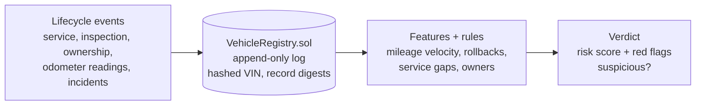

# VehiclePassport

A tamper-evident lifecycle record for vehicles, with a machine-learning detector
that spots fraud. Every service, inspection, part replacement, ownership
transfer, and odometer reading is appended to an on-chain log; a RandomForest
model, backed by deterministic rule checks, reads the full history and flags
odometer rollbacks and inconsistent records.

The two halves work together. The chain gives a history that no one can quietly
rewrite — so the data the model reasons over is trustworthy. The model turns that
history into a clear verdict with reasons.

[](.github/workflows/ci.yml)
[](pyproject.toml)
[](LICENSE)

---

## Why it matters

Odometer fraud is common and expensive: a rolled-back odometer makes a car look
younger and worth more than it is. The tell-tale signs live in the vehicle's
history — a reading that drops, a jump too large to be real, a suspicious gap —
but only if that history is complete and trustworthy. A paper service book can be
forged; a shared, append-only ledger cannot be edited after the fact.

VehiclePassport records the history where it cannot be tampered with, then
analyses it:

- **Append-only and tamper-evident.** Each event is a permanent on-chain entry
  with a timestamp and a digest of the off-chain record.
- **The chain never "fixes" the data.** A lower odometer than before is exactly
  what fraud looks like, so the contract stores it faithfully and lets the
  detector flag it.
- **Explainable verdicts.** Every risk score comes with plain-language red flags
  ("odometer rollback: 61,000 km dropped to 35,000 km").
- **Private.** No VIN or owner data reaches the chain — only a hashed id, event
  codes, odometer values, and record digests.

## How it works



1. **Registry (`chain/` + `contracts/`).** The `VehicleRegistry` contract stores,
   per vehicle, an append-only list of events. Only authorised recorders (the
   passport service, workshops, inspection centres) can append; each event keeps
   an odometer value, a timestamp, and the keccak digest of the off-chain detail.
2. **Features (`features.py`).** From a vehicle's history it builds a feature
   vector (mileage per year, number and size of rollbacks, maximum km/day between
   readings, service intervals, owner count) and a set of deterministic red
   flags.
3. **Detector (`detector.py`).** A RandomForest trained on labelled honest and
   tampered histories produces a risk score. A hard red flag (a rollback or an
   implausible jump) marks the vehicle suspicious regardless of the score —
   because a dropped odometer is not a matter of probability.

The same service can run against the real compiled contract (on an in-memory
PyEVM node or a live JSON-RPC endpoint such as Anvil) or against an in-memory
fake with identical behaviour, so the tests and the API behave the same with or
without a chain.

## Quick start

```bash
python -m venv .venv && source .venv/bin/activate
pip install -e ".[dev]"

# Deploy to an in-memory EVM, record two vehicles, and assess them:
python -m vehiclepassport.cli demo

# Run the HTTP API:
uvicorn vehiclepassport.main:app --reload
```

Example API calls:

```bash
# Record a lifecycle event
curl -s -X POST localhost:8000/vehicles/VIN-123/events -H 'content-type: application/json' -d '{
  "event_type": "service", "odometer_km": 48000, "timestamp": 1760000000
}'

# Read the full history and the risk assessment
curl -s localhost:8000/vehicles/VIN-123/history
curl -s localhost:8000/vehicles/VIN-123/assessment
```

## The smart contract

`contracts/src/VehicleRegistry.sol` is compiled with a pinned `solc-js` compiler,
so no native toolchain is needed and the path is identical locally and in CI:

```bash
make compile   # node contracts/compile.js -> contracts/artifacts/VehicleRegistry.json
```

The compiled artifact (ABI + bytecode) is committed, so the runtime and the
tests can deploy the contract to any JSON-RPC endpoint without a compiler.

Key design points:

- **No VIN or owner data on-chain.** A vehicle is a `bytes32` id (a hash of its
  VIN). The off-chain record detail stays off-chain; only its digest is anchored.
- **Authorised recorders.** Only addresses the operator has authorised (a
  workshop, an inspection centre, the service) can append events.
- **Faithful, not corrective.** The contract stores a decreasing odometer exactly
  as submitted — the fraud must be preserved, not rejected, so it can be detected.
- **Custom errors** (`NotOperator`, `NotRecorder`, `ZeroVehicle`) keep reverts
  cheap and clear.

## Configuration

Settings load from environment variables with the `VP_` prefix (see
`.env.example`):

| Variable               | Default             | Meaning                                    |
| ---------------------- | ------------------- | ------------------------------------------ |
| `VP_RISK_THRESHOLD`    | `0.5`               | Risk score at/above which a car is flagged |
| `VP_MAX_KM_PER_DAY`    | `1500`              | Sustained km/day above this is implausible |
| `VP_CHAIN_ENABLED`     | `true`              | Use a real chain for the registry          |
| `VP_CHAIN_RPC_URL`     | `http://anvil:8545` | JSON-RPC endpoint                          |
| `VP_CONTRACT_ADDRESS`  | `""`                | Deployed `VehicleRegistry` address         |
| `VP_CHAIN_PRIVATE_KEY` | `""`                | Recorder key for signing writes            |

Never commit a real private key. Leave `VP_CHAIN_PRIVATE_KEY` empty for local
runs; the API and tests use an in-memory EVM or the in-memory fake.

## Evaluation: a legitimate high score, proven not memorised

The detector scores very highly, which deserves scrutiny — a near-perfect number
is often a sign of overfitting or of a test set that leaks the training
distribution. Here it is legitimate, and `vehiclepassport.evaluation` proves it
rather than asserting it:

```
$ python -m vehiclepassport.evaluation
  5-fold CV F1        : 0.99 +/- 0.01    # stable, not a lucky split
  independent test F1 : 0.99             # test histories from a different seed
  train-test gap      : 0.01             # tiny -> not overfit
```

Two things make the high score honest, unlike a text classifier memorising
templates: each vehicle history is an **independent random draw** (not a reused
template), so the test set does not leak training phrasings; and the features are
**engineered to capture the fraud directly** (a rollback *is* a negative odometer
delta), so the relationship the model learns is real, not spurious. The 5-fold
cross-validation shows low variance and the independent-seed test set confirms
generalisation, so the model is neither underfit (it scores near the ceiling the
features allow) nor overfit (the train/test gap is ~0.01). The deterministic
hard-flag rules then guarantee the obvious cases regardless of the model.

## Testing

```bash
ruff check vehiclepassport tests
pytest --cov=vehiclepassport --cov-report=term-missing --cov-fail-under=80
```

The suite covers the event vocabulary, the feature extraction and red flags, the
detector (a held-out accuracy check plus a cross-validated, independent-test
overfitting-gap check), the HTTP API, and the contract (deployed to an in-memory
EVM, including recorder authorisation and the guarantee that a rollback is
preserved). Tests that deploy the contract carry the `chain` marker.

## Documentation

- `docs/architecture.md` — the full picture and the data flow.
- `docs/adr/` — the main design decisions and why they were made.
- `docs/estudio/` — a study guide in Spanish, for learning the project in depth.

## License

MIT. See [LICENSE](LICENSE).
