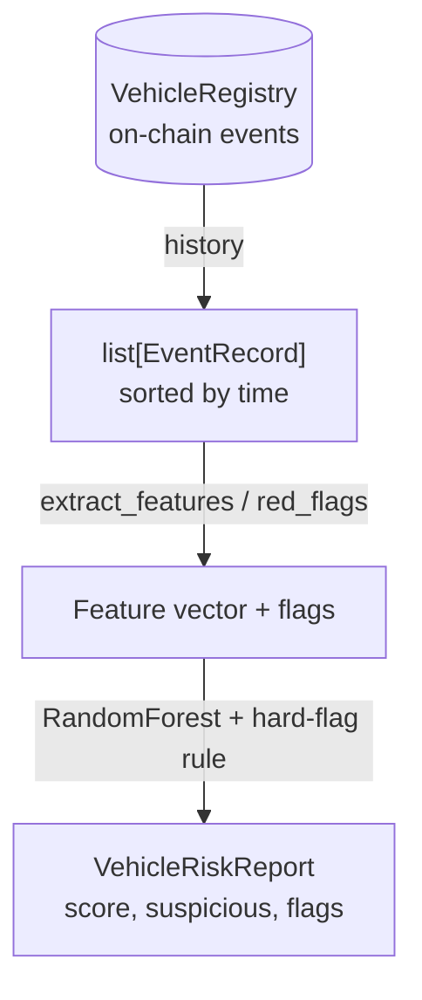

# Architecture

VehiclePassport records a vehicle's lifecycle on an append-only on-chain log and
analyses that history to flag tampering. This document describes the pieces, how
data flows through them, and the boundaries between them.

## The pieces

| Layer          | Module                             | Responsibility                                            |
| -------------- | ---------------------------------- | --------------------------------------------------------- |
| Vocabulary     | `vehiclepassport/events.py`        | Event types, mirrored from the Solidity enum              |
| Data           | `vehiclepassport/generate.py`      | Synthetic honest and tampered histories, labelled         |
| Features       | `vehiclepassport/features.py`      | History → feature vector + deterministic red flags        |
| Detector       | `vehiclepassport/detector.py`      | Risk score (RandomForest) + hard-flag override            |
| Orchestration  | `vehiclepassport/service.py`       | Record events and assess a vehicle end to end             |
| Registry client| `vehiclepassport/chain/registry.py`| Talk to the contract (or an in-memory fake)               |
| Artifacts      | `vehiclepassport/chain/artifacts.py`| Load the committed ABI + bytecode                        |
| Compiler       | `vehiclepassport/chain/compile.py` | Build the artifact from Solidity via `solc-js`            |
| Contract       | `contracts/src/VehicleRegistry.sol`| Append-only lifecycle log on-chain                        |
| HTTP API       | `vehiclepassport/main.py`          | Record events, read history, assess risk over REST        |
| CLI            | `vehiclepassport/cli.py`           | End-to-end demo against an in-memory EVM                  |

## Data flow for an assessment

## Why the chain stores the data faithfully, flaws and all

It is tempting to make the contract reject a decreasing odometer. That would be
a mistake. A dropped reading is precisely the fraud we want to catch; if the
contract refused it, the fraud would simply happen off-chain and the ledger would
look clean. So the contract is **faithful, not corrective**: it appends whatever
an authorised recorder submits, and the detector — not the contract — decides
what is suspicious. The chain's job is integrity of the record, not judgement.

## The odometer timeline

Not every event is a mileage measurement. A service, inspection, part
replacement, or explicit odometer reading carries a trustworthy value; an
ownership transfer or an incident may carry a last-known or stale value. So the
feature layer builds its mileage timeline from the measurement events only
(`ODOMETER_EVENTS`). This is deliberately conservative: a value a fraudster could
set freely at a transfer does not anchor the analysis.

## Two signals, combined

The detector combines a learned signal and a rule signal:

- **RandomForest risk score.** Trained on labelled histories, it picks up soft,
  combined patterns — irregular servicing, odd mileage variance, an owner count
  out of step with the age. It outputs a probability.
- **Deterministic red flags.** A rollback (any decrease) or an implausible jump
  (km/day above a physical threshold) is found by a direct rule and stated in
  plain language.

A hard red flag marks the vehicle suspicious regardless of the model score. This
is important: the probabilistic model should never be able to "vote away" a
rollback that plainly happened. The model adds sensitivity to subtler cases; the
rules guarantee the obvious ones are never missed.

When the model flags a vehicle with no hard red flag, the report explains *that
vehicle*: `model_factors` is a per-instance explanation — the features where this
history deviates most from an honest car, as a signed z-score weighted by the
model's importances — rather than a global feature ranking that would read the
same for every vehicle. So even a model-only verdict is inspectable.

## The registry boundary

`RegistryClient` is a `Protocol` with two implementations:

- **`Web3RegistryClient`** talks to a deployed `VehicleRegistry` over JSON-RPC and
  signs transactions when given a private key. It also exposes `set_recorder` for
  the operator to authorise workshops.
- **`InMemoryRegistryClient`** mirrors the contract's append-only history in a
  dictionary.

Both satisfy the same protocol, so the service, the API, and the tests do not
care which is behind them. A dedicated test records the same events on both and
asserts the histories agree, so the fake cannot drift.

## Privacy

Nothing that identifies a vehicle or its owner is written on-chain. A vehicle is
a `bytes32` id (the keccak hash of its VIN). The full record detail (the workshop,
the line items, notes) stays off-chain; only its keccak digest is anchored, which
proves the detail has not changed without revealing it.

## Compilation strategy

The Solidity source is compiled by a pinned `solc-js` compiler invoked through
`node contracts/compile.js`. There is no native `solc` to install, so the build
is identical on a laptop and in CI. The resulting artifact (ABI + bytecode) is
committed under `contracts/artifacts/`, which lets the runtime and the tests
deploy the contract to any endpoint without running a compiler.

## Extension points

- **Detector.** The RandomForest is a strong, explainable baseline. A sequence
  model over the event stream could replace it behind the same `assess`
  interface.
- **Rules.** New red flags (a title-status check, a mismatch against a
  manufacturer service schedule) slot into `features.red_flags`.
- **Registry target.** Pointing `VP_CHAIN_RPC_URL` and `VP_CONTRACT_ADDRESS` at a
  live node is the only change needed to record on a real chain.
