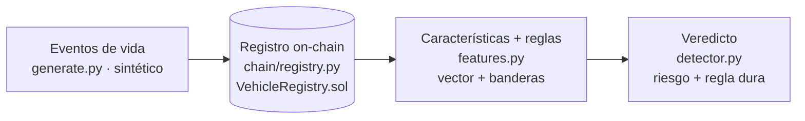

# 04 — Arquitectura y decisiones de diseño

## Las piezas, de principio a fin

Por encima: la **API HTTP** (`main.py`, FastAPI) y la **CLI** (`cli.py`, una demo
de principio a fin contra una EVM en memoria).

## Flujo de una evaluación

1. `service.get_history(vin)` lee del registro (cadena o fake) la lista de
   eventos del vehículo, ordenada por tiempo.
2. `features.extract_features` + `features.red_flags` convierten el historial en
   un vector de números y una lista de banderas rojas.
3. `detector.assess` calcula el riesgo con el RandomForest y aplica la regla dura:
   si hay rollback o salto imposible, es sospechoso pase lo que pase.
4. Se devuelve un `VehicleRiskReport` con puntuación, decisión, banderas y
   factores del modelo.

## Decisión 1: el contrato es fiel, no corrector

Ya explicada en la guía 01: el contrato guarda hasta los valores sospechosos. La
cadena garantiza integridad; el juicio vive en el detector. Separación limpia de
responsabilidades.

## Decisión 2: modelo + reglas, con reglas que mandan

Ya explicada en la guía 02: el modelo aporta sensibilidad a lo sutil; las reglas
garantizan que lo obvio nunca se escapa. Una regla dura siempre gana.

## Decisión 3: el registro es opcional (un `Protocol` y un fake)

`RegistryClient` es un `Protocol` con dos implementaciones:

- `Web3RegistryClient`: habla con el contrato real por JSON-RPC y firma
  transacciones; además expone `set_recorder` para que el operador autorice
  talleres.
- `InMemoryRegistryClient`: imita el historial append-only en un diccionario.

El servicio, la API y las pruebas dependen solo del `Protocol`. Así la API
funciona con o sin cadena, las pruebas de IA son rápidas (sin nodo) y una prueba
de equivalencia comprueba que el fake y el contrato coinciden, para que el fake no
se desvíe. Es **inversión de dependencias**: lo de alto nivel no depende de web3,
sino de una interfaz.

## Decisión 4: compilar con solc-js y versionar el artefacto

El contrato se compila con `solc-js` (fijado en npm) vía `node compile.js`. No
hace falta un `solc` nativo, y la compilación es idéntica en tu portátil y en CI.
El artefacto (ABI + bytecode) se versiona, así que el runtime y las pruebas
despliegan el contrato **sin compilador**. Si cambia el contrato, se regenera con
`make compile` y el cambio aparece en el diff.

## Decisión 5: configuración por variables de entorno

`config.py` usa `pydantic-settings` con prefijo `VP_`. Nunca se escribe una clave
privada en el código; en local se deja vacía y se usa la EVM en memoria. La
configuración vive en el entorno, no en el código.

## Puntos de extensión

- **Detector:** cambiar el RandomForest por un modelo de secuencia sobre el flujo
  de eventos, con la misma interfaz `assess`.
- **Reglas:** añadir banderas nuevas (estado del título, desajuste con el plan de
  mantenimiento del fabricante) en `features.red_flags`.
- **Destino del registro:** apuntar `VP_CHAIN_RPC_URL` y `VP_CONTRACT_ADDRESS` a
  un nodo real para registrar en una cadena de verdad.

## Para fijar la idea

- Capas claras: datos → cadena → características/reglas → veredicto.
- Contrato fiel, modelo+reglas, registro opcional tras un `Protocol`.
- Artefacto versionado → builds reproducibles y sin compilador en ejecución.
